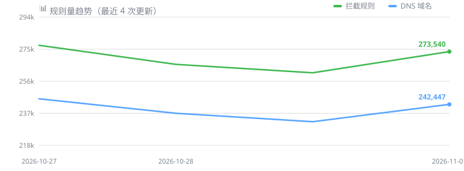

<div align="center">

<a id="top"></a>

# 🛸 天影规则聚合 · TianYing Rules Hub

**⚡ 强力去广告 · 每日自动更新 · 全平台适配 ⚡**

> 干净的网络，从一条订阅开始 —— 20 路数据源聚合 · 三层真实去重 · 每日自动更新，一套规则覆盖 11 种格式

[](https://github.com/xiaolei7172/ADS/actions/workflows/Update-Rules.yml)
[](https://github.com/xiaolei7172/ADS/commits/master)
[](LICENSE)

[📥 规则订阅](#-规则订阅中心) · [🚀 快速开始](#-快速开始) · [📦 客户端下载](#-客户端下载速查) · [📊 实时统计](#-实时项目统计) · [📚 上游数据源](#-上游规则数据源) · [🧪 拦截测试](#-拦截效果在线测试) · [📜 更新历史](#-更新历史)

---

## 📊 实时项目统计

### 🔮 天影规则聚合 · 实时规则规模


🕒 **更新时间**：2026-11-13 19:52:17（北京时间）


🚫 **广告拦截规则**：258757 条


🌐 **DNS 拦截域名**：231976 个


✅ **白名单放行规则**：6777 条（约半数可在 DNS 层直接生效，其余为浏览器版 AdGuard 的路径级 / `$domain=` 规则，DNS 层无效）

<!-- DL_STATUS_START -->
✅ **上游源状态**：21/21 全部下载成功
<!-- DL_STATUS_END -->



<!-- 🏷️ 动态徽章：① 在 gist.github.com 新建一个 Gist；② 仓库 Settings → Secrets 新建 GIST_SECRET（需 gist 权限的 Token）、Settings → Variables 新建 GIST_ID（填 Gist ID）；③ 取消下一行注释并把 <GIST_ID> 换成实际 ID

-->

---

## 🎯 十三大保障

| 保障 | 说明 |
| :--- | :--- |
| 🧹 **真实去重** | 精确去重 + 大小写归一 + 父子域语义去重，0 冗余规则 |
| 🛡️ **质量闸门** | 每次发布前自检重复/冗余/计数自洽，并专查三件一致性校验抓不到的事：**白名单有没有被父域拦截架空**、**170 个关键功能域有没有被整域误拦**（政务/银行/支付/交通/系统更新/公共 CDN，名单见 `data/mod/critical-domains.txt`）、**本地自定义规则里有没有已经 NXDOMAIN 的死域名**（本地规则豁免死规则过滤，删不掉也发现不了，只能交叉核对），不合格自动拦截 |
| 🔍 **格式一致** | 93 个用例 × 8 种拦截产物逐格式比对同一域名的判定，另有一层 golden 文件把产物语法逐字节锁死（改了写法却忘了改解析器，这里立刻红）；任何格式走偏当场拦下（历史上的 qx / hosts / dnsmasq 三次漏拦都是它抓出来的） |
| ☠️ **死规则清理** | 每周探测一遍全部拦截域名，双 DNS 服务器确认 NXDOMAIN 的才会进 `data/mod/dead.txt`，上游规则命中即剔除——规则只增不减会让客户端越来越慢、抖振越来越难查 |
| 📉 **来源骤降熔断** | 某路上游「HTTP 200 但只返回半截」时，与 7 日中位数比，跌超 50% 且绝对量掉 500 条以上即中止发布（`AdRules` 一家占半壁，它腰斩就是十万条一夜蒸发） |
| 🚧 **发布护栏** | 规则量骤降 >10% 或低于 5 万条即中止发布，绝不带病上线 |
| 🧯 **投毒熔断** | 白名单移除拦截规则 >8%（正常 ≈2%）即判定投毒/黑白错配，中止发布；下载阶段同步做黑白方向体检 |
| 🎯 **精确剔除** | 上游把整个公司主域 / API 网关一锅端时，按域名逐条拆除，子域规则与白名单不受牵连 |
| 🪄 **可信通配** | 上游通配白名单（如 `v*.douyinvod.com`）经人工甄别后落地展开，广告混入的通配保持忽略 |
| 🏷️ **版本标签** | 每天打 `vYYYY.MM.DD` 标签，raw 链接可用 tag 锁版本；出误杀能 diff 相邻两版直接定位是哪天改坏的 |
| 🌐 **多源容灾** | GitHub API + 3 个 jsDelivr 子域 + gh-proxy 共 6 通道下载兜底 |
| 🚨 **失败可见** | 更新失败自动开 issue + 写运行摘要 + 上传产物，规则不会静默停在几天前（可用 `workflow_dispatch` 勾选 `simulate_failure` 自测这条链路） |
| 📋 **来源可溯** | 每条规则标注所属上游来源，排查误杀一步定位 |

---

## ⚠️ 必读：拦截规则必须配合白名单使用

> **只订阅拦截规则，等于把误杀的概率全部收下。** 本仓库聚合 20 路上游，其中一部分源会按「公司主域」整族下发拦截。
> 2026-11 就出过一次：拼多多的图片 / 视频 / 直播 CDN 根域 `pddpic.com` 被上游当成广告域拦掉，
> 表现是图片白块、直播转圈、短视频打不开、评价晒图裂图——**放行的唯一手段就是白名单**。

### 为什么单靠拦截规则一定会误杀

| 环节 | 现实 |
| :--- | :--- |
| 上游粒度 | 上游常按公司主域下发（`\|\|pddpic.com^`），一条规则带走该域下所有子域 |
| DNS 层匹配 | `address=/pddpic.com/0.0.0.0`、`DOMAIN-SUFFIX,pddpic.com`、`+.pddpic.com`、`\|\|pddpic.com^` 全是**后缀匹配** |
| 白名单粒度 | 所以白名单必须**整域放行**（`@@\|\|pddpic.com^`）才有效；只写 `@@\|\|img.pddpic.com^` 这种子域会被父域规则直接吃掉 |

### 各客户端怎么配（白名单是否生效）

| 客户端 | 拦截规则 | 白名单 | 白名单是否生效 |
| :--- | :--- | :--- | :--- |
| AdGuard（Win / Mac / Android） | `adblock.txt`（可再加 `dns.txt`） | `allow.txt` | ✅ 两个都要订阅，`@@` 例外优先于拦截 |
| AdGuard Home | `dns.txt` | `allow.txt`（自定义过滤规则 → 放行） | ✅ 同上 |
| SmartDNS | `smartdns.conf` | `smartdns-whitelist.conf` | ✅ 配套文件，必须一起 `conf-file` |
| dnsmasq / OpenWrt | `dnsmasq.conf` | 无对应白名单格式 | ⚠️ 见下方兜底说明 |
| hosts / 系统 hosts | `hosts.txt` | 无对应白名单格式 | ⚠️ 同上 |
| QX / Surge / Mihomo | `qx.list` / `surge.list` / `mihomo.yaml` | 单文件格式，不支持 `@@` 例外 | ⚠️ 同上 |

> 单文件格式（dnsmasq / hosts / QX / Surge / Mihomo）一个文件就要装完所有规则，客户端根本不会去加载 `allow.txt`。
> 所以在这些客户端上，**子域白名单等于没写**——这也是拼多多那次「白名单明明有，用户还是打不开」的真正原因。

### 本仓库的兜底：让单文件格式不必自救

`merge.py` 在合并阶段就按白名单做了**父子域剔除**：每次构建有七千余条拦截规则因白名单而移除，
成品里不会出现「白名单域被父域拦」的死结。所以即使你的客户端不加载 `allow.txt`，
`dnsmasq.conf` / `hosts.txt` / `qx.list` 这些单文件产物本身已经是「白名单已生效」的版本。

但有三件事兜不住，需要你知道：

1. **白名单里只有约一半能在 DNS 层生效**：`allow.txt` 共 6,777 条，纯域名 + 通配 3,501 条可直接生效，
   其余 3,276 条是路径级 / `$domain=` / 正则，只有浏览器版 AdGuard 认。
2. **上游白名单本身会失效**：近三百条上游白名单已被父域架空，且随上游每日漂移，只能统计、不能当发布闸门。
   本地白名单新出现的同类冲突会被 `check-quality.py` 当场拦住（存量基线登记在 `data/mod/allow-conflicts.baseline`，每次运行会打印实际条数）。
3. **误杀可能是当天新出现的**：上游随时新增过宽规则，成品每日重建，问题也可能今天才有。

### 遇到误杀怎么办

1. **定位**：`grep -i 域名 data/rules/dns.txt`，命中行上方的分区注释直接告诉你是哪路上游拦的；
2. **判定**：媒体 CDN / 支付 / 政务 / 登录 / 地图一般该放行；广告投放、统计上报、SDK 埋点该保留；
3. **放行**：提到 [Issues](https://github.com/xiaolei7172/ADS/issues) 由仓库侧整域放行（推荐，一次修好所有人）；
   急着用就先在客户端手动加一条 **整域** 例外 `@@||example.com^`——写成 `@@||img.example.com^` 在 DNS 层无效。

---

## 📺 APP 视频广告：能拦什么，拦不了什么

> 2026-11-07 实测。DNS 层只看域名，不看 URL 路径——所以「视频广告」要分类型谈。

### 能拦住的（本仓库已覆盖）

| 广告形态 | 拦截原理 | 对应域名 |
|---|---|---|
| **开屏视频** | 走独立广告 SDK 域 | 穿山甲 `pangolin-sdk-toutiao*.com`、优量汇 `sdk.e.qq.com` |
| **激励视频** | 走聚合 SDK 请求入口 | TopOn `*-api/adx/tk.anythinktech.com`、Sigmob `dc.sigmob.cn` |
| **插屏 / 信息流视频** | 走联盟接口 | 快手联盟 `api.e.kuaishou.com`、百度 `nadvideo.baidu.com` |
| **长视频贴片（部分）** | 只能拦广告调度域 | 爱奇艺 `cupid.iqiyi.com`、腾讯视频 `adss.video.qq.com` |

四个联盟的覆盖情况：穿山甲 11/11、百度联盟 8/8、优酷 4/4、优量汇 13/13。

### 字节系三件套专项：红果短剧 / 番茄小说 / 抖音（2026-11 加固）

这三款同属字节，广告链是同一套：**TNC 调度 → ads 计费 → 素材 CDN**。上一版只覆盖了老集群，实测仍有广告，按命名空间枚举后找到三个结构性缺口：

| 缺口 | 证据 | 后果 |
|---|---|---|
| **TNC 调度换了代** | `tnc{0,3,11}-{alisc1,aliec2,bjlgy}.{zijieapi.com,snssdk.com}` 枚举 217 个候选，只有 40 个存活；老规则只写了 tnc0/tnc3 的 6 条，**tnc11 六条一条没有** | tnc 决定"这个位置放哪条广告"。拦不住它，广告照常被选中，只拦素材等于白拦 |
| **抖音广告签名只拦了一半** | 广告图签名有 `p*-ad-sign.byteimg.com` 和 `p*-ad-sign.douyinpic.com` 两套，后者一条没拦 | 抖音开屏/信息流广告图照常下载 |
| **广告素材 CDN 整段缺失** | `p*-ad.bytecdn.cn`（广告视频）、`p*-ad-aweme.byteimg.com`（抖音广告图）实测存活，DD-AD 源也收录同款 | 广告能播，只是被跳过前多耗流量 |

补了 13 条（TNC 调度 6 + 素材 CDN 7），同时把 8 条早已 NXDOMAIN 的本地规则清掉，净增 5 条。

**主动放弃的一条**：`abtest3-misc-lf/lq.zijieapi.com` 原本也打算拦（新广告位靠它灰度上线），但上游 `dangchu` 白名单专门点名放行了 `lf` 分片——它是 **A/B 实验配置下发**，不是广告投放链路，拦了会让新功能推不下来。按「只拦投放链路、不拦配置下发」的线放弃。

> ⚠️ **已知副作用，先说清楚**：TNC 拦截可能让番茄「小说评论区」空白。上游 `changzhaoCZ/fqnovel-adrules` 里有一条被注释掉的 `@@||tnc*-*.zijieapi.com^` 就是为此。如果遇到了，删掉 `data/mod/adblock.txt` 模块L 里的 tnc11 六行即可恢复，代价是广告回来一部分。

**正片与广告的判定只差一个词**，所以这次把它们写进了 `critical-domains.txt` 当闸门，上游哪天想整域端掉就直接红：

```
正片                                             广告
v11-reading-video.qznovelvod.com        vs      v11-reading-ad.qznovelvod.com
p3-novel-sign.byteimg.com               vs      p3-ad-sign.byteimg.com
p3.douyinpic.com（图床）                 vs      p3-ad-sign.douyinpic.com
```

### 拦不住的（别抱期望）

- **抖音 / 快手信息流广告**：广告与正片同域名、同 CDN，DNS 层无解；
- **B 站视频内嵌广告**：与稿件同源，只能走客户端规则；
- **爱奇艺 / 腾讯视频完整去广告**：贴片与正片共用一个播放接口，认域名分不出来。

### ⛔ 禁拦清单（拦了正片/功能直接废）

```
api.bilibili.com        B 站全站 API —— 拦了 App 打不开
vv.video.qq.com         腾讯视频播放地址接口（返回 JSON 播放串）
t5.a.yximgs.com         快手图床 —— 拦了全站碎图
wxsnsdy.wxs.qq.com      朋友圈视频 —— 拦了掉红包封面
v.qq.com / y.qq.com     腾讯视频 / QQ音乐主站
```

以上域名已写入 `data/mod/critical-domains.txt`，`check-quality.py` 第 7 项会拦发布。

### 副作用提醒

激励视频被拦后，部分 App 会提示「广告加载失败，无法领取奖励」——这是预期行为，不是规则出错。需要领奖励时，临时关掉本规则即可。

---

## 🚀 快速开始

> 💡 先把客户端装好，再贴订阅链接。下面全部为**官方来源**（链接已实测可达）；GitHub Releases 在国内不稳时，可在链接前加 `https://gh-proxy.com/` 加速。

### 📦 客户端下载速查

| 软件 | 适用平台 | 官方下载 | 备注 |
| :--- | :--- | :--- | :--- |
| **AdGuard** | Windows / macOS / Android | [官网下载](https://adguard.com/zh_cn/download.html) | 商业软件（有试用），系统级全局拦截 |
| **AdGuard Home** | Win / macOS / Linux / Docker | [GitHub Releases](https://github.com/AdguardTeam/AdGuardHome/releases) | 免费开源，自建 DNS 服务器 |
| **OpenWrt** | 路由器 | [固件选择器](https://firmware-selector.openwrt.org/) · [ImmortalWrt](https://github.com/immortalwrt/immortalwrt) | 免费开源路由系统，国内推荐后者 |
| **SmartDNS** | Linux / OpenWrt | [GitHub Releases](https://github.com/pymumu/smartdns/releases) | 免费开源，DNS 加速 + 拦截 |
| **Clash Verge Rev** | Win / macOS / Linux | [GitHub Releases](https://github.com/clash-verge-rev/clash-verge-rev/releases) | 免费开源图形客户端，最常用 |
| **Mihomo Party** | Win / macOS / Linux | [GitHub Releases](https://github.com/mihomo-party-org/mihomo-party/releases) | 免费开源，开箱即用 |
| **Mihomo 内核** | 全平台（命令行） | [GitHub Releases](https://github.com/MetaCubeX/mihomo/releases) | 进阶自建 / 软路由用 |
| **Quantumult X** | iOS / iPadOS | [App Store](https://apps.apple.com/app/quantumult-x/id1443988620) | 付费买断，需美区/港区账号 |
| **Surge** | iOS / macOS | [nssurge.com](https://nssurge.com) | 付费订阅；官网国内直连不稳，需自备网络 |

<details open>
<summary><b>🖥️ AdGuard（Windows / Mac / Android）</b></summary>
<br>

> 📥 下载：[Windows](https://adguard.com/zh_cn/adguard-windows/overview.html) · [macOS](https://adguard.com/zh_cn/adguard-mac/overview.html) · [Android](https://adguard.com/zh_cn/adguard-android/overview.html) · [全部平台](https://adguard.com/zh_cn/download.html)

1. 打开 AdGuard → 设置 → **内容拦截**（Windows 为「过滤器」）
2. 点击「添加过滤器」→「使用自定义过滤器」
3. 粘贴订阅链接（国内网络选加速列）：
   `https://testingcf.jsdelivr.net/gh/xiaolei7172/ADS@master/data/rules/adblock.txt`
4. **必须同时启用白名单**（不加会误杀，原理见上方「必读」）：`https://testingcf.jsdelivr.net/gh/xiaolei7172/ADS@master/data/rules/allow.txt`

</details>

<details>
<summary><b>🌐 AdGuard Home</b></summary>
<br>

> 📥 下载：[GitHub Releases](https://github.com/AdguardTeam/AdGuardHome/releases) · 也支持 Docker（`docker run -p 53:53/tcp -p 53:53/udp -p 3000:3000 adguard/adguardhome`）

1. 管理后台 → 过滤器 → **DNS 拦截列表** → 添加拦截列表
2. 粘贴：`https://testingcf.jsdelivr.net/gh/xiaolei7172/ADS@master/data/rules/dns.txt`
3. **必须加上白名单**（自定义过滤规则 → 放行），不加会误杀：`https://testingcf.jsdelivr.net/gh/xiaolei7172/ADS@master/data/rules/allow.txt`

</details>

<details>
<summary><b>📡 OpenWrt / dnsmasq 路由器</b></summary>
<br>

> 📥 固件：[官方固件选择器](https://firmware-selector.openwrt.org/) · [ImmortalWrt（国内源更全）](https://github.com/immortalwrt/immortalwrt) · OpenClash 插件：[Releases](https://github.com/vernesong/OpenClash/releases)

**方式一：dnsmasq 规则（推荐，后缀匹配，子域一起拦）**

1. SSH 登录路由器，把规则下到 dnsmasq 配置目录：
   `wget -O /etc/dnsmasq.d/tianying.conf https://testingcf.jsdelivr.net/gh/xiaolei7172/ADS@master/data/rules/dnsmasq.conf`
2. 让 dnsmasq 加载它：主配置 `/etc/dnsmasq.conf` 里若有 `conf-dir=/etc/dnsmasq.d` 即可直接生效；没有就追加一行
   `echo 'conf-file=/etc/dnsmasq.d/tianying.conf' >> /etc/dnsmasq.conf`
3. 重启服务：`/etc/init.d/dnsmasq restart`

> `address=/域名/0.0.0.0` 会连同该域名的全部子域一起作答。想顺带拦 IPv6，可把 `0.0.0.0` 全局替换为 `#`（需 dnsmasq ≥ 2.86），或改用 `local=/域名/` 直接答 NXDOMAIN。
>
> ✅ **白名单不用另装**：dnsmasq 没有 `@@` 例外语法，一个文件装完。本仓库已在构建时按白名单剔除拦截规则
> （见上方「必读」），所以这份 `dnsmasq.conf` 本身就是「白名单已生效」的版本。若仍误伤某个域名，
> 在 `/etc/dnsmasq.d/` 下自建一个 `whitelist.conf` 写 `server=/域名/#` 覆盖即可，或提 issue 由仓库侧修复。

**方式二：hosts（老固件兜底，无 conf-dir 时用）**

1. 下载 hosts 文件：`https://testingcf.jsdelivr.net/gh/xiaolei7172/ADS@master/data/rules/hosts.txt`
2. 覆盖到 `/etc/hosts` 末尾（或配合 dnsmasq 的 `addn-hosts` 引用）
3. 重启 dnsmasq：`/etc/init.d/dnsmasq restart`

> ⚠️ **hosts 只能精确匹配**：`0.0.0.0 a.b.com` 拦不到 `x.a.b.com`。本仓库的 hosts.txt 已把 dns.txt 折叠掉的 1.4 万个子域补回（比 dns.txt 多约 1.4 万条，含上游明确列出的全部域名），但上游没列出的子域仍然拦不到。要彻底覆盖子域，请优先用 **dns.txt（AdGuard Home）/ dnsmasq.conf / smartdns.conf / surge.list / mihomo.yaml / qx.list** 这些后缀匹配格式。
>
> ⚠️ **hosts 同样没有白名单机制**：`/etc/hosts` 里写了 `0.0.0.0 x.com` 就没法用白名单放行。本仓库已在构建时按白名单剔除（见上方「必读」），所以这份 hosts.txt 不会出现「白名单域被拦」的条目；自己往 `/etc/hosts` 追加规则时要单独留意这一点。

</details>

<details>
<summary><b>🔍 SmartDNS</b></summary>
<br>

> 📥 下载：[GitHub Releases](https://github.com/pymumu/smartdns/releases)（OpenWrt 可直接 `opkg install smartdns`）

1. 编辑 `smartdns.conf`，加入：`conf-file https://testingcf.jsdelivr.net/gh/xiaolei7172/ADS@master/data/rules/smartdns.conf`
   （或下载后 `include` 到主配置）
2. **必须一起加载白名单**（不加会误杀，见上方「必读」）：`conf-file .../data/rules/smartdns-whitelist.conf`
3. 重启服务：`/etc/init.d/smartdns restart`

</details>

<details>
<summary><b>🧩 Clash / Mihomo</b></summary>
<br>

> 📥 客户端：[Clash Verge Rev](https://github.com/clash-verge-rev/clash-verge-rev/releases) · [Mihomo Party](https://github.com/mihomo-party-org/mihomo-party/releases) · [Mihomo 内核](https://github.com/MetaCubeX/mihomo/releases)

```yaml
rule-providers:
  tianying-ad:
    type: http
    behavior: domain
    url: "https://testingcf.jsdelivr.net/gh/xiaolei7172/ADS@master/data/rules/mihomo.yaml"
    path: ./rules/tianying-ad.yaml
    interval: 43200
rules:
  - RULE-SET,tianying-ad,REJECT
```

> ✅ **白名单不用另配**：`behavior: domain` 规则集没有 `@@` 例外语法。本仓库已在构建时按白名单剔除拦截规则
> （见上方「必读」），这份 `mihomo.yaml` 本身就是「白名单已生效」的版本。
> 若仍误伤，可在 `rules` **最前面**加 `DOMAIN-SUFFIX,域名,DIRECT` 让该域走直连——顺序优先于 `REJECT`。

</details>

---

## 📥 规则订阅中心

> 💡 国内网络推荐优先使用「国内加速链接」（jsDelivr，实测可用）；GitHub 直连不稳时再换直链。
> PC 版 AdGuard 选 `adblock.txt`；AdGuard Home / OpenWrt 选 `dns.txt`。
>
> ⚠️ **无论选哪个拦截格式，都要配套加载白名单**（见下方「白名单规则」）。只装拦截不装白名单 = 没有误杀保护。

<details open>
<summary><b>🚫 广告拦截规则</b></summary>
<br>

| 规则类型 | 适用平台 | 📥 GitHub直链 | 🚀 国内加速链接 |
| :---- | :---- | :---- | :---- |
| AdGuard 拦截规则 | AdGuard 全家桶 | [adblock.txt](https://raw.githubusercontent.com/xiaolei7172/ADS/master/data/rules/adblock.txt) | [adblock.txt](https://testingcf.jsdelivr.net/gh/xiaolei7172/ADS@master/data/rules/adblock.txt) |
| AdGuard Home DNS拦截规则 | AdGuard Home / OpenWrt | [dns.txt](https://raw.githubusercontent.com/xiaolei7172/ADS/master/data/rules/dns.txt) | [dns.txt](https://testingcf.jsdelivr.net/gh/xiaolei7172/ADS@master/data/rules/dns.txt) |

</details>


<details>
<summary><b>📋 仅域名规则</b></summary>
<br>

| 规则类型 | 适用平台 | 📥 GitHub直链 | 🚀 国内加速链接 |
| :---- | :---- | :---- | :---- |
| 黑名单域名列表 | 通用（可自行转换） | [ad-domain.txt](https://raw.githubusercontent.com/xiaolei7172/ADS/master/data/rules/ad-domain.txt) | [ad-domain.txt](https://testingcf.jsdelivr.net/gh/xiaolei7172/ADS@master/data/rules/ad-domain.txt) |

</details>


<details>
<summary><b>📱 Quantumult X 规则</b></summary>
<br>

> 📥 客户端：[Quantumult X（App Store，付费）](https://apps.apple.com/app/quantumult-x/id1443988620)　|　导入位置：配置文件 →「引用」的 `[filter_remote]` 段

| 规则类型 | 适用平台 | 📥 GitHub直链 | 🚀 国内加速链接 |
| :---- | :---- | :---- | :---- |
| Quantumult X 规则 | Quantumult X | [qx.list](https://raw.githubusercontent.com/xiaolei7172/ADS/master/data/rules/qx.list) | [qx.list](https://testingcf.jsdelivr.net/gh/xiaolei7172/ADS@master/data/rules/qx.list) |

</details>


<details>
<summary><b>🔍 SmartDNS 规则</b></summary>
<br>

| 规则类型 | 适用平台 | 📥 GitHub直链 | 🚀 国内加速链接 |
| :---- | :---- | :---- | :---- |
| SmartDNS 拦截规则 | SmartDNS | [smartdns.conf](https://raw.githubusercontent.com/xiaolei7172/ADS/master/data/rules/smartdns.conf) | [smartdns.conf](https://testingcf.jsdelivr.net/gh/xiaolei7172/ADS@master/data/rules/smartdns.conf) |
| SmartDNS 白名单 | SmartDNS | [smartdns-whitelist.conf](https://raw.githubusercontent.com/xiaolei7172/ADS/master/data/rules/smartdns-whitelist.conf) | [smartdns-whitelist.conf](https://testingcf.jsdelivr.net/gh/xiaolei7172/ADS@master/data/rules/smartdns-whitelist.conf) |

</details>


<details>
<summary><b>🛠 dnsmasq 规则（OpenWrt / Pi-hole / 软路由）</b></summary>
<br>

> 后缀匹配：`address=/域名/0.0.0.0` 连同该域名的全部子域一起拦截，比 hosts 的精确匹配更彻底，也是家用路由最省事的方案。

| 规则类型 | 适用平台 | 📥 GitHub直链 | 🚀 国内加速链接 |
| :---- | :---- | :---- | :---- |
| dnsmasq 拦截规则 | OpenWrt / Pi-hole / 梅林 / 爱快（dnsmasq 后端） | [dnsmasq.conf](https://raw.githubusercontent.com/xiaolei7172/ADS/master/data/rules/dnsmasq.conf) | [dnsmasq.conf](https://testingcf.jsdelivr.net/gh/xiaolei7172/ADS@master/data/rules/dnsmasq.conf) |

</details>


<details>
<summary><b>📛 HOSTS 拦截规则</b></summary>
<br>

| 规则类型 | 适用平台 | 📥 GitHub直链 | 🚀 国内加速链接 |
| :---- | :---- | :---- | :---- |
| HOSTS 格式（0.0.0.0） | 路由器 / 系统 hosts / 无 root 安卓 | [hosts.txt](https://raw.githubusercontent.com/xiaolei7172/ADS/master/data/rules/hosts.txt) | [hosts.txt](https://testingcf.jsdelivr.net/gh/xiaolei7172/ADS@master/data/rules/hosts.txt) |

</details>


<details open>
<summary><b>✅ 白名单规则（必装 · 与拦截规则配套使用）</b></summary>
<br>

> ⚠️ **这不是可选项。** 只订阅拦截规则、不订阅白名单，等于放弃误杀保护——上游按主域整族下发时
> 会把正常功能一起拦掉（拼多多 CDN 就是这么坏的，详见上方「必读」）。
> 单文件格式（dnsmasq / hosts / QX / Surge / Mihomo）的白名单已在构建时剔除进成品，无需另装；
> AdGuard 全家桶与 SmartDNS 必须自己加载下面这份。

| 规则类型 | 适用平台 | 📥 GitHub直链 | 🚀 国内加速链接 |
| :---- | :---- | :---- | :---- |
| 白名单规则（误杀放行） | AdGuard 全家桶（**必装**） | [allow.txt](https://raw.githubusercontent.com/xiaolei7172/ADS/master/data/rules/allow.txt) | [allow.txt](https://testingcf.jsdelivr.net/gh/xiaolei7172/ADS@master/data/rules/allow.txt) |
| SmartDNS 白名单 | SmartDNS（**必装**） | [smartdns-whitelist.conf](https://raw.githubusercontent.com/xiaolei7172/ADS/master/data/rules/smartdns-whitelist.conf) | [smartdns-whitelist.conf](https://testingcf.jsdelivr.net/gh/xiaolei7172/ADS@master/data/rules/smartdns-whitelist.conf) |

> 📌 白名单必须**整域**才有效：`@@||example.com^` 管用，`@@||img.example.com^` 在 DNS 层会被父域拦截规则吃掉。
> 需要新增放行请在 [Issues](https://github.com/xiaolei7172/ADS/issues) 提出，仓库侧一次修好所有订阅者。

</details>


<details>
<summary><b>🧩 Clash / Mihomo / Surge 规则</b></summary>
<br>

> 📥 客户端：[Clash Verge Rev](https://github.com/clash-verge-rev/clash-verge-rev/releases) · [Mihomo Party](https://github.com/mihomo-party-org/mihomo-party/releases) · [Surge](https://nssurge.com)（付费，官网需自备网络）

| 规则类型 | 适用平台 | 📥 GitHub直链 | 🚀 国内加速链接 |
| :---- | :---- | :---- | :---- |
| Mihomo 域名集 | Clash / Mihomo / Stash（behavior: domain） | [mihomo.yaml](https://raw.githubusercontent.com/xiaolei7172/ADS/master/data/rules/mihomo.yaml) | [mihomo.yaml](https://testingcf.jsdelivr.net/gh/xiaolei7172/ADS@master/data/rules/mihomo.yaml) |
| Surge 规则集 | Surge / Loon（RULE-SET） | [surge.list](https://raw.githubusercontent.com/xiaolei7172/ADS/master/data/rules/surge.list) | [surge.list](https://testingcf.jsdelivr.net/gh/xiaolei7172/ADS@master/data/rules/surge.list) |

</details>


<details>
<summary><b>🔄 公共 DNS 服务器节点</b></summary>
<br>

| 节点 | 地址 |
| :---- | :---- |
| 天影公共 DNS | `https://tianying.pub.xlxbk.cn/xlxbk/api` |
| 18bit DoH | `https://doh.18bit.cn/dns-query` |
| 360 DoH | `https://doh.360.cn/dns-query` |
| 阿里 DoH | `https://dns.alidns.com/dns-query` |
| 腾讯 DoH | `https://doh.pub/dns-query` |
| XLXBK API | `https://pub.xlxbk.cn/xlxbk/api` |

</details>

</div>


## 🏷️ 版本标签：出问题能回滚

每天规则更新后会打一个版本标签 `vYYYY.MM.DD`（同日多次更新为 `vYYYY.MM.DD-2`、`-3`）。

**为什么需要**：raw 订阅链接永远指向 master 最新版。某天规则改坏了，用户只能干等修复，既没法退回昨天那版，也无从判断「是哪天的改动让我这里出问题」。有了标签就有参照点。

```bash
# 看最近几个版本
git tag --sort=-creatordate | head -5

# 哪天改坏的：直接 diff 两个版本
git diff v2026.11.01 v2026.11.07 -- data/rules/dns.txt

# 锁版本订阅（raw 链接支持 tag 引用，不会随 master 变动）
https://raw.githubusercontent.com/xiaolei7172/ADS/v2026.11.07/data/rules/dns.txt
```

标签不重指（Git 的 tag 一旦推送就固定），所以「回滚」= 把订阅地址里的 `master` 换成某个历史 tag。「查到问题版本」= 在相邻两个 tag 之间 diff，改动只有几百行，几分钟能定位。


## 📚 上游规则数据源

> 管线实际下载 **20 路源**（14 个拦截 + 6 个白名单），另有 6 个本仓库自定义文件（黑名单 / 白名单 / 精确剔除表 / 可信通配表 / 白名单冲突基线 / 关键功能域名单）。
> 其中「合并源」本身已聚合多个二级上游，因此实际覆盖的项目数量多于 19。
> 每个来源在成品中都有分区标注，误拦可直接定位到源。

<details>
<summary><b>点击查看全部数据来源</b></summary>
<br>

### 🔴 拦截规则（14 路）

| 来源 | 侧重 | 原始地址 |
| :--- | :--- | :--- |
| 📛 **1007-Hosts** | Hosts 混合源（已含其 reward 全部域名） | [10007_auto/all](https://raw.githubusercontent.com/lingeringsound/10007_auto/master/all) |
| 📛 **anti-AD 官方规则** | 命中率高、兼容性强 | [anti-ad.net/easylist.txt](https://anti-ad.net/easylist.txt) |
| 📛 **AdRules DNS List** | DNS 专用 | [gp.adrules.top/dns.txt](https://gp.adrules.top/dns.txt) |
| 📛 **AdGuard DNS Filter 官方** | DNS 专用（官方维护） | [AdGuardSDNSFilter](https://adguardteam.github.io/AdGuardSDNSFilter/Filters/filter.txt) |
| 📛 **OISD 拦截规则** | DNS 专用，低误杀 | [small.oisd.nl](https://small.oisd.nl/) |
| 📛 **个人合并规则** | 合并源（群主维护） | [666/rules.txt](https://raw.githubusercontent.com/qq5460168/666/master/rules.txt) |
| 📛 **酷安@大萌主** | 接口 / SDK 广告 | [banad/jiekouAD.txt](https://raw.githubusercontent.com/damengzhu/banad/main/jiekouAD.txt) |
| 📛 **浮风拦截规则** | 合并源 | [ad-rules-merged](https://raw.githubusercontent.com/Thelongdarkorg/ad-rules-merged/main/merged.txt) |
| 📛 **海哥规则** | 国内 App 专项（腾讯/字节/小米/番茄系） | [HG/hg1.txt 官方镜像](https://github.com/2771936993/HG/blob/main/hg1.txt) |
| 📛 **秋风广告规则** | 综合拦截 | [AWAvenue-Ads-Rule](https://raw.githubusercontent.com/TG-Twilight/AWAvenue-Ads-Rule/main/AWAvenue-Ads-Rule.txt) |
| 📛 **乘风视频规则** | 视频贴片广告 | [Adblock-Plus-Rule/mv.txt](https://raw.githubusercontent.com/xinggsf/Adblock-Plus-Rule/master/mv.txt) |
| 📛 **乘风通用规则** | 通用拦截 | [Adblock-Plus-Rule/rule.txt](https://raw.githubusercontent.com/xinggsf/Adblock-Plus-Rule/master/rule.txt) |
| 📛 **晴雅拦截规则** | 综合拦截 | [qy-Ads-Rule/black.txt](https://raw.githubusercontent.com/rssvcn/qy-Ads-Rule/main/black.txt) |
| 📛 **abclq Hosts 拦截规则** | Hosts 综合拦截 | [home-dns-adblock hosts](https://raw.githubusercontent.com/abclq/home-dns-adblock/refs/heads/main/dist/hosts.txt) |
| 🏠 **本仓库自定义** | 红果短剧 / 番茄小说专项等 | [data/mod/adblock.txt](https://raw.githubusercontent.com/xiaolei7172/ADS/master/data/mod/adblock.txt) |

### 🟢 白名单规则（6 路 + 自定义）

| 来源 | 侧重 | 原始地址 |
| :--- | :--- | :--- |
| ✅ **当初白名单** | 综合放行 | [dangchu/white.txt](https://raw.githubusercontent.com/qq5460168/dangchu/main/white.txt) |
| ✅ **李文杰白名单** | 中文站点放行 | [adg-rules/white.txt](https://raw.githubusercontent.com/liwenjie119/adg-rules/master/white.txt) |
| ✅ **AdGuard 中文白名单** | 官方中文放行 | [ChineseFilter/allowlist](https://raw.githubusercontent.com/AdguardTeam/AdguardFilters/master/ChineseFilter/sections/allowlist.txt) |
| ✅ **AdGuard 跟踪白名单** | 官方隐私放行 | [SpywareFilter/allowlist](https://raw.githubusercontent.com/AdguardTeam/AdguardFilters/master/SpywareFilter/sections/allowlist.txt) |
| ✅ **BlueSkyXN 白名单** | AdGuard Home 专用 | [AdGuardHomeRules/ok.txt](https://raw.githubusercontent.com/BlueSkyXN/AdGuardHomeRules/master/ok.txt) |
| ✅ **abclq 防误杀白名单** | 红果/抖音正片 CDN 防误杀（裸域名格式，自动转换） | [home-dns-adblock whitelist](https://raw.githubusercontent.com/abclq/home-dns-adblock/refs/heads/main/config/whitelist.txt) |
| 🏠 **本仓库自定义** | 误杀补救（优先级最高） | [data/mod/whitelist.txt](https://raw.githubusercontent.com/xiaolei7172/ADS/master/data/mod/whitelist.txt) |

> 📎 另有 6 条功能域手工摘录自 [lingeringsound/10007_auto 的 Adaway 白名单](https://raw.githubusercontent.com/lingeringsound/10007_auto/master/Adaway_white_list.prop)（DoH 端点 / 推送 HTTPDNS / 小米云 / 百度图床 / 淘宝鉴权 / Adobe 授权）。该源整包 331 条中 289 条已与现有白名单重合，剩余多为 `alimama`、`adnxs`、`ads.tiktok` 等纯广告域，**未作为自动源接入**，仅摘录不接会坏功能的几条。
>
> 📎 UC 浏览器改用 12 条功能子域点名放行（`u3` / `cms` / `ucsec` / `safe` / `wap3` / `kwurl` / `client.video` / `napi` 等），取代原来的 `@@||ucweb.com^` 整域放行——详见下方「精确剔除表」。

### 🎯 精确剔除表：拆掉过宽的那一条，不牵连子域

上游最常见的两种"一锅端"事故：把整个公司主域拦了，或者把整个域名放行了。白名单治不了前者（放行整域会连带废掉几十条子域拦截，副作用比问题本身还大），黑名单也治不了后者。

`data/mod/exclude.txt` 提供了第三条路——**按域名逐条对齐，只删这一条规则**：

| 场景 | 处理 | 效果 |
| :--- | :--- | :--- |
| 上游拦了 `\|bytedance.com^`（整公司主域） | 剔除该条 | 配置下发 `tnc3-*`、设备标识 `ttwid`、小程序容器 `microapp` 恢复；`mssdk`/`pitaya` 等埋点子域照旧拦 |
| 上游拦了 `\|api5-normal-lf.fqnovel.com^`（番茄内容 API） | 剔除整族 `api{3,5}-normal-*` | 番茄小说正文与章节恢复；`log*-applog`/`mon*-misc` 等埋点照旧拦 |
| 上游白名单放了 `@@\|ucweb.com^`（整域） | 同时剔除它与 `\|ucweb.com^` | UC 的 `adtrack`/`ucads`/`union`/`insight`/`utp` 等 18 条广告追踪域恢复拦截；`u3`/`cms`/`ucsec`/`safe` 等功能子域点名放行 |
| 上游拦了 `\|360.cn^` / `\|2345.com^` / `\|wechat.com^`（整公司主域） | 剔除主域三条 | 360 安全卫士、2345 导航、微信国际版恢复解析；同时上游单列的 107 条广告子域（`ad.360.cn`、`pop.360.cn`、`ssp.2345.com` …）从父子域折叠中露出、继续拦截 |
| 上游白名单放了 `@@\|ad.doubleclick.net^` / `@@\|qznovelvod.com^` | 剔除放行侧两条 | Google DART 展示广告、番茄小说阅读页 `vN-reading-ad` 共 7 条恢复拦截 |

> ⚠️ 剔除主域会带来一个连带效应：父子域去重此前把该域下的子域规则折叠了，主域一旦解除，这些子域规则会全部浮出。所以还要复查新露出的子域有没有误伤功能（本轮就因此补放了 `appstore.360.cn` / `jiagu.360.cn` / `mcloud.360.cn`，并把 `wechat.com` 改成整域放行）。

### 🪄 可信通配表：上游通配白名单的 DNS 层落地

上游白名单里 517 条 `@@||v*.douyinvod.com^` 这类**通配放行**在 DNS 层全部静默失效（域名集合只收纯域名），上游黑名单拦掉的节点无人兜底——抖音/B站/番茄的视频节点、腾讯下载 CDN、360 图片 CDN 就是这样被误伤的。

但**不能盲目展开**：实测展开全部 517 条会放行 76 条规则，其中近半是广告/埋点域（`ad.a.yximgs.com` 快手广告集群、`tipsdk.baidu.com` 百度推广追踪、`amdc.alipay.com` 调度埋点都在其中）。所以采用**可信模式表** `data/mod/wildcard_allow.txt`：只有整组确认都是功能/CDN 域的模式（抖音视频节点 `v*.douyinvod.com`、B站播放镜像 `upos-sz-*.bilivideo.com`、腾讯 hash 下载 CDN `*.dlied1.cdntips.net` 等 6 条）才会展开成具体放行条目；混着广告的通配继续忽略，改用白名单点名放行其中的功能域。展开结果写入 allow.txt 的「可信通配展开」独立分区，可溯源、可审计。

### 🩺 关键功能域名单：拦了就是功能故障，不是少看广告

`data/mod/critical-domains.txt` 收录 170 个「拦掉就等于功能坏掉」的域名——政务、银行、支付、运营商、交通、地图、系统更新、公共 CDN，以及大厂主力产品的登录 / 支付 / 内容 API。`check-quality.py` 第 7 项逐个核对：**域名自身被拦、或任一上级域被拦（后缀匹配连带），当场红**。

为什么需要它：`verify-fixes.py` 只比对「8 种格式判得一样不一样」，八种格式一致地错它抓不到；白名单冲突闸门只管我们自己写的放行有没有生效，管不到上游新拦了一个不该拦的。2026-11-07 那次体检就靠这份名单 + 逐条 DNS 实测抓到三起：

| 域名 | 拦它的规则 | 实测证据 | 后果 |
| :--- | :--- | :--- | :--- |
| `bank.pingan.com` | `\|\|pingan.com^`（海哥源整域） | 200 正常银行页，CDN 回源 `pool-bank.pingan.com.cdngtm.com` | 平安银行 / 保险 / 好车主全线不可用 |
| `www.10jqka.com.cn` | `\|\|www.10jqka.com.cn^`（精确） | 200，`Server: Stargate`，CNAME → `webcache.10jqka.com.cn` | 行情站首页打不开 |
| `gchat.qpic.cn` | `\|\|gchat.qpic.cn^`（海哥源） | `Server: NWSs`（腾讯自研），微信群图宿主 | 群聊图片全裂、表情发不出 |

三条均已放行（整域 / 精确）。名单带例外语法：行尾 `#exact-ok` 表示「这条精确规则可以存在，但父域不许拦」，例如 `s.bdstatic.com` 这类百度 CDN 宿主——拦它只影响那一个宿主，不牵连整站。

`verify-fixes.py` 已接进 CI（`Verify Format Consistency` 步骤），用 93 个用例把 dns / qx / surge / smartdns / dnsmasq / mihomo / ad-domain 七种后缀匹配格式逐个比对，状态必须完全一致，任何格式走偏直接让工作流红掉；hosts 因只能精确匹配单独核对（已补回折叠前的子域，上游未列出的子域仍拦不到），相关用例标 `†`。改 `common.py` 的域名词法后，另有一层纯函数单测：`python -m unittest discover -s tests -v`。

### 🧽 上游脏数据清洗

合并过程中会主动丢弃以下三类"看着像规则、实际有害或无效"的行：

| 类型 | 为例 | 为什么要丢 |
| :--- | :--- | :--- |
| `$badfilter` | `pl.ua^$badfilter` | AdGuard 里用于取消规则，留着等于反向放行广告 |
| 尾点多一个句点 | `advertising.civitai.` | 语法无效，纯废行 |
| 非回环 IP 映射行 | `110.43.121.13 bigota.d.miui.com` | 这是 hosts 加速映射而非拦截，会把域名强行指向某个 IP |

> 💡 **域名词法为什么值得单独看**：`valid_domain` 的 TLD 规则一度只认 `[a-z]{2,24}`，把 `.中国`（`xn--fiqs8s`）、`.рф`（`xn--p1ai`）这类 punycode TLD 整条丢掉。放宽后 `dns.txt` 多了 25 条，而同一批合并的 `adblock.txt` **字节数一条没变**——这恰好证明那 25 条一直躺在上游数据里，只是被旧正则漏掉了：修复的是解析口径，不是新增了规则。改域名词法后请对照这两份产物的大小变化，能立刻判断是"补回漏掉"还是"真的多了"。

### ☠️ 死规则清理：只拦还存在的域名

上游规则只增不减。随机抽样实测，约一成域名早已是 **NXDOMAIN**——一次性垃圾域（`uujhveglpo.xyz` 这类随机串）、活动结束就下线的推广域、换过品牌的旧域。它们不会自己消失，只会越积越多：拖慢客户端匹配、让「今天拦明天不拦」的抖振更难排查、把真正有效的规则淹在噪声里。

判定口径很保守，**只认 NXDOMAIN，且必须两台不同 DNS 服务器都返回**：

| 环节 | 做法 | 为什么 |
| :--- | :--- | :--- |
| 初判 | UDP 直连 `223.5.5.5` / `119.29.29.29`，**限速 150 条/秒**，每 3 万条歇 20 秒 | 无 TLS 握手、单包往返；DoH 被服务端限流封顶 32 条/秒。限速与冷却都是必需：裸跑 300 条/秒时公共 DNS 开始丢包，实测 24.6 万条跑完错误率 **63.9%**，整轮作废 |
| 续传 | 每 3 万条把结果落盘（`data/tmp/probe-state.json`），超时域下轮自动重测 | 公共 DNS 的配额在持续打压下会收紧，一轮跑不完是常态；中断一次丢掉 40 分钟结果比重试更贵 |
| 复核 | 换**另一台**服务器重查，两次都 `RCODE=3` 才算死 | 单台 DNS 抽风把整个 TLD 返回 NXDOMAIN 会批量误删，换服务器可挡 |
| 保守保留 | 超时 / SERVFAIL / 两次结果不一致 → 一律不判死 | 宁可多留一条，不可错删一条 |
| 自动复活 | 每次探测都把旧 `dead.txt` 全量重探，能解析的移出 | 广告域换 CDN 复活很常见，清单不需要人工维护 |

**为什么不用 `socket.getaddrinfo` 判死**：它在「NOERROR 但没有 A 记录」时也抛 `11001`（`WSAHOST_NOT_FOUND`）。实测 `analytics.tdameritrade.com` 被本地解析器判死，三家 DoH 全部返回 `Status=0`——域名活着，只是没配 A 记录。这条"捷径"实测误判率约 1/3，用它清理会删掉大量正常规则。

结果写入 `data/mod/dead.txt`，`merge.py` 读到即剔除对应**上游**规则。本地自定义规则（`data/mod/adblock.txt`）豁免——用户明确要拦的域，不该由脚本替用户删。

三道安全阀，任一触发都不写盘：网络错误率 >15%（链路有问题）、死域占比 >40%（多半是 DNS 被劫持）、清单体量超过上游拦截总数 35%（`merge.py` 侧整份忽略，防清单被写坏清空产物）。探测由独立工作流每周日跑一次（`Probe-Dead-Rules.yml`），日更流程只读结果、不承担探测成本。

### 🔬 新源接入：先验证，后接入

收到一个新规则源 URL 时，不直接挂进管线，先用**源探针**验证：

```bash
python data/python/probe_source.py <规则源URL>          # 自动分辨黑白名单 + 冲突预演
python data/python/probe_source.py <规则源URL> allow    # 已知是白名单时强制按白名单分析
python data/python/probe_source.py <规则源URL> block    # 已知是黑名单时强制按黑名单分析
```

探针会输出四段报告：

| 环节 | 回答的问题 |
| :--- | :--- |
| 📥 试下载 | 六通道镜像能否拉到？是不是 404/挑战页冒充的规则？ |
| 🧭 黑白判定 | 放行(@@)/拦截(\|\|)/hosts 语法占比 + 文件名关键词，自动判定它是白名单还是黑名单 |
| ⚗️ 冲突预演 | 白名单：将解封现有多少条拦截规则（列出域名明细）；黑名单：与现有规则重叠多少、净新增多少 |
| 📌 接入建议 | 该进 `allow_rules` 还是 `adblock_rules`，后续验证跑哪些脚本 |

**黑白名单怎么分辨？** 核心看语法而非文件名：

| 特征 | 白名单 | 黑名单 |
| :--- | :--- | :--- |
| `@@\|\|domain^` | ✅ 主要成分 | 一般少量（上游自带防误杀） |
| `\|\|domain^` / `0.0.0.0 domain` | 一般少量 | ✅ 主要成分 |
| 裸域名（一行一个域名） | 看文件名：whitelist/allow 等 → 按 `@@\|\|domain^` 转换接入 | 看文件名：adblock/hosts 等 → 作拦截域名接入 |

**正式管线的双保险**（探针之外的自动防线）：

- **下载方向体检**（dl.py）：白名单文件里拦截语法占大头 / 黑名单文件里放行语法占大头，下载阶段当场报警；
- **白名单污染熔断**（merge.py）：若白名单放行移除的拦截规则超过 **8%**（正常水位 ≈2%），判定白名单被投毒或黑白错配，中止发布残缺规则。

**本地跑一遍完整管线**（顺序不能乱）：

```bash
python data/python/dl.py           # 下载 20 路上游（六通道容灾）
python data/python/merge.py        # 合并 + 白名单过滤（含投毒熔断）
python data/python/filter-dns.py   # 生成 dns.txt + 折叠前域名集
python data/python/pipeline.py     # 一次生成 8 种派生格式
python data/python/title.py && python data/python/clean-readme.py && python data/python/changelog.py
python data/python/trend.py
python data/python/check-quality.py && python data/python/verify-fixes.py
```

> 🔧 **改格式只改一处**：8 种派生格式的「写一行 / 读一行 / 来源 / 匹配语义」全部声明在
> `data/python/formats.py` 的 `FORMATS` 里，生成、质量闸门、一致性校验共用同一份 reader。
> 新增一种格式 = 加一个 `Format(...)`；只重生成某一种 = `python data/python/pipeline.py qx.list`。
> 域名词法（`common.py` 的 `valid_domain` 等）另有一层纯函数单测：`python -m unittest discover -s tests -v`。

</details>


<!-- CHANGELOG:START -->
## 📜 更新历史

> 仅收录**功能性变更**；CI 每日的例行规则更新（`✅ 规则自动更新` 提交）不列出。完整记录见 [Commits](https://github.com/xiaolei7172/ADS/commits/master)。

### 📅 2026-11-13

| 类型 | 变更内容 | 提交 |
| :--- | :--- | :--- |
| 🧹 清理 | dns.txt 头部去掉「来源汇总」块——与 title.py 生成的「☑ 规则来源统计」完全重复 | [`1f6e501`](https://github.com/xiaolei7172/ADS/commit/1f6e501) |

<details>
<summary><b>📅 2026-11-12</b> · 1 项变更</summary>

| 类型 | 变更内容 | 提交 |
| :--- | :--- | :--- |
| 🧹 清理 | 清理模块F(AD-QGG)指向死域的 262 条规则（run#5 探测确认 NXDOMAIN，质检熔断 run#438） | [`132ff8f`](https://github.com/xiaolei7172/ADS/commit/132ff8f) |

</details>

<details>
<summary><b>📅 2026-11-11</b> · 6 项变更</summary>

| 类型 | 变更内容 | 提交 |
| :--- | :--- | :--- |
| ☠ 清理 | 死规则清单更新 2026-11-11 16:45 | [`566ff8a`](https://github.com/xiaolei7172/ADS/commit/566ff8a) |
| 🩹 修复 | Report Failure 改用 body-file（bash printf 对多字节中文报 invalid format character，run#4 实测） | [`4ffa89b`](https://github.com/xiaolei7172/ADS/commit/4ffa89b) |
| 🔐 其他 | Report Failure 步骤补 issues: write 权限（run#3 中 gh issue create 静默失败） | [`ef94e6d`](https://github.com/xiaolei7172/ADS/commit/ef94e6d) |
| 🔧 修复 | 探测提交竞态修复 + 预置 11-08 快照 | [`e4712d8`](https://github.com/xiaolei7172/ADS/commit/e4712d8) |
| ⚡ 其他 | 死规则探测改增量模式 + 🧩 接入茯苓上游 | [`51da94c`](https://github.com/xiaolei7172/ADS/commit/51da94c) |
| 📦 其他 | AD-QGG 精选 2,222 条进本地自定义规则；探测回退双服务器 | [`e965ae8`](https://github.com/xiaolei7172/ADS/commit/e965ae8) |

</details>

<details>
<summary><b>📅 2026-11-10</b> · 2 项变更</summary>

| 类型 | 变更内容 | 提交 |
| :--- | :--- | :--- |
| ⚡ 其他 | 死规则探测提速：4 台独立运营商 DNS 聚合 QPS 翻倍 + 浅克隆 checkout | [`1f4c659`](https://github.com/xiaolei7172/ADS/commit/1f4c659) |
| 🪓 其他 | 拆父域机制：修复 1007-Hosts 新增 ads.heytapmobi.com 整域拦截架空白名单导致的熔断 | [`791fd39`](https://github.com/xiaolei7172/ADS/commit/791fd39) |

</details>

<details>
<summary><b>📅 2026-11-08</b> · 2 项变更</summary>

| 类型 | 变更内容 | 提交 |
| :--- | :--- | :--- |
| ☠ 清理 | 死规则清单更新 2026-11-08 19:01 | [`5c2c560`](https://github.com/xiaolei7172/ADS/commit/5c2c560) |
| 📖 文档 | 仓库体检修复：README 白名单数字改为现算 + 版本标签改轻量 | [`01a733a`](https://github.com/xiaolei7172/ADS/commit/01a733a) |

</details>

<details>
<summary><b>📅 2026-11-07</b> · 8 项变更</summary>

| 类型 | 变更内容 | 提交 |
| :--- | :--- | :--- |
| 📖 文档 | 更新历史补录 + 死规则清理那条归到「☠ 清理」 | [`0e1f0fb`](https://github.com/xiaolei7172/ADS/commit/0e1f0fb) |
| 🎯 规则调优 | 红果/番茄/抖音 广告漏拦补全：TNC 调度换代 + 素材 CDN 缺失 | [`6ad12d4`](https://github.com/xiaolei7172/ADS/commit/6ad12d4) |
| ☠ 清理 | 死规则清理 + 来源骤降熔断 + 版本标签：治三件长期运行的慢性病 | [`41b2941`](https://github.com/xiaolei7172/ADS/commit/41b2941) |
| 🐛 修复 | 修复：更新历史漏生成 + 无 emoji 的提交被归入「其他」 | [`5641903`](https://github.com/xiaolei7172/ADS/commit/5641903) |
| ✨ 新增 | 补全 APP 视频/开屏广告 SDK，拆掉 5 条放行广告服务器的白名单 | [`d3b306a`](https://github.com/xiaolei7172/ADS/commit/d3b306a) |
| 🩺 修复 | 关键功能域体检：修 3 起整站误拦 + 新增「关键域不得被整域拦」闸门 | [`fcff0a8`](https://github.com/xiaolei7172/ADS/commit/fcff0a8) |
| 📖 文档 | README 增加「必读」章节：拦截规则必须配合白名单使用 | [`bfadf4e`](https://github.com/xiaolei7172/ADS/commit/bfadf4e) |
| 🐛 修复 | 修拼多多「多处异常」：4 条媒体 CDN 被误拦 + 白名单被父域架空 | [`2dd9cde`](https://github.com/xiaolei7172/ADS/commit/2dd9cde) |

</details>

<details>
<summary><b>📅 2026-11-01</b> · 19 项变更</summary>

| 类型 | 变更内容 | 提交 |
| :--- | :--- | :--- |
| 🩹 修复 | 告警链路用真 gh 实测后修正：issue URL 打到日志、标题覆盖校验失败 | [`79a0a38`](https://github.com/xiaolei7172/ADS/commit/79a0a38) |
| 🔧 修复 | 按第二轮审查落地：告警链路改 gh CLI、golden 字节锁、hosts 改内容指纹 | [`5f8d658`](https://github.com/xiaolei7172/ADS/commit/5f8d658) |
| ♻ 其他 | P1 重构：8 份格式脚本合成 formats.py + pipeline.py，产物逐字节一致 | [`5630a08`](https://github.com/xiaolei7172/ADS/commit/5630a08) |
| 🔧 修复 | 按代码审查报告落地 P0 + P3：一致性校验进 CI、失败可见、语义层加固 | [`f11067a`](https://github.com/xiaolei7172/ADS/commit/f11067a) |
| 🛠 其他 | 新增 dnsmasq 格式产物（dnsmasq.conf） | [`6d3c828`](https://github.com/xiaolei7172/ADS/commit/6d3c828) |
| 🔹 其他 | ⏱️ 更新频率改为每日一次（北京时间 08:17） | [`e062ec1`](https://github.com/xiaolei7172/ADS/commit/e062ec1) |
| 🩺 修复 | 产物体检：qx 改后缀匹配、hosts 补回折叠子域、白名单标注 DNS 口径 | [`695555a`](https://github.com/xiaolei7172/ADS/commit/695555a) |
| 📜 其他 | README 新增「更新历史」章节：由 git log 自动生成，随 CI 刷新 | [`cd001c3`](https://github.com/xiaolei7172/ADS/commit/cd001c3) |
| 💄 优化 | 表头统计块排版优化：📈 → ☑ 修复破损占位框；数字列缩进 5→2 空格 | [`1c28066`](https://github.com/xiaolei7172/ADS/commit/1c28066) |
| 🪄 新机制 | 可信通配表：修复 517 条上游通配白名单在 DNS 层静默失效的问题 | [`ed60a3e`](https://github.com/xiaolei7172/ADS/commit/ed60a3e) |
| 📊 功能 | 三个合并文件表头新增「规则来源统计」：打开规则页第一屏可见各上游条数 | [`100c714`](https://github.com/xiaolei7172/ADS/commit/100c714) |
| 🎬 修复 | 红果短剧 / 番茄小说播放链路修复：16+1 条视频节点从"通配失效"中救回 | [`95e23f8`](https://github.com/xiaolei7172/ADS/commit/95e23f8) |
| 🩺 修复 | 产物体检并修复：3 条大厂主域整杀 + 2 条白名单放行广告 | [`8e8c77a`](https://github.com/xiaolei7172/ADS/commit/8e8c77a) |
| 🎯 规则调优 | 修复三处过宽规则：字节整域拦截 / 番茄内容 API / UC 整域放行 | [`24b629e`](https://github.com/xiaolei7172/ADS/commit/24b629e) |
| 🧹 清理 | 移除冗余源 1007-reward：实测是 all 的严格子集，单独下载贡献 0 条 | [`5bf3caf`](https://github.com/xiaolei7172/ADS/commit/5bf3caf) |
| 📖 文档 | README 白名单段补注：6 条功能域为手工摘录，非自动源 | [`86e3843`](https://github.com/xiaolei7172/ADS/commit/86e3843) |
| 🩹 修复 | 白名单补 6 条功能域：DoH / 推送 HTTPDNS / 小米云 / 百度图床 / 淘宝鉴权 / Adobe 授权 | [`8d7cee8`](https://github.com/xiaolei7172/ADS/commit/8d7cee8) |
| 🎯 规则调优 | 腾讯广告精确拦截：134 条广告域绕过 qq.com 整域放行 | [`3cdff84`](https://github.com/xiaolei7172/ADS/commit/3cdff84) |
| 🔧 修复 | 修复海哥规则源：改用官方 GitHub 镜像 + 补齐国内 App 覆盖 | [`2a6cfff`](https://github.com/xiaolei7172/ADS/commit/2a6cfff) |

</details>

<details>
<summary><b>📅 2026-10-29</b> · 1 项变更</summary>

| 类型 | 变更内容 | 提交 |
| :--- | :--- | :--- |
| 🔕 变更 | 关闭自动发布：移除 CI 中的自动 Release 步骤 | [`669cc47`](https://github.com/xiaolei7172/ADS/commit/669cc47) |

</details>

<details>
<summary><b>📅 2026-10-28</b> · 8 项变更</summary>

| 类型 | 变更内容 | 提交 |
| :--- | :--- | :--- |
| 🔧 修复 | 仓库体检修复：探针重复条数统计 + 保障表收录投毒熔断 | [`2ccdb82`](https://github.com/xiaolei7172/ADS/commit/2ccdb82) |
| 🔧 修复 | API 推送行尾归一化（CRLF→LF），修复上一次 API 通道推入的 Windows 行尾 | [`0173282`](https://github.com/xiaolei7172/ADS/commit/0173282) |
| 🔬 新机制 | 新增源探针：先验证后接入 + 黑白名单自动分辨 | [`3817f79`](https://github.com/xiaolei7172/ADS/commit/3817f79) |
| ➕ 新增源 | 接入 abclq Hosts 拦截规则（第 21 路源） | [`147f5a6`](https://github.com/xiaolei7172/ADS/commit/147f5a6) |
| ➕ 新增源 | 接入 abclq 防误杀白名单（第 20 路源）+ 裸域名格式自动转换 | [`76d40ef`](https://github.com/xiaolei7172/ADS/commit/76d40ef) |
| 📋 文档 | 建立完整 Issue 反馈体系（误拦/漏拦/新源/其他四类） | [`8b3d70c`](https://github.com/xiaolei7172/ADS/commit/8b3d70c) |
| 🧽 清理 | 清洗上游脏规则 + 重写上游源表 + workflow 加固 | [`65e5358`](https://github.com/xiaolei7172/ADS/commit/65e5358) |
| 💄 优化 | 项目改名「天影规则聚合 Rules Hub」+ 快速开始补齐客户端下载地址 | [`73634af`](https://github.com/xiaolei7172/ADS/commit/73634af) |

</details>

<details>
<summary><b>📅 2026-10-27</b> · 12 项变更</summary>

| 类型 | 变更内容 | 提交 |
| :--- | :--- | :--- |
| ✨ 新增 | 新增 Clash/Surge 格式 + 下载并发 + README 快速开始教程 | [`cc43ecd`](https://github.com/xiaolei7172/ADS/commit/cc43ecd) |
| 💄 优化 | README 全面美化：徽章行/五大保障/平台适配列/修复公共DNS坏表格/上游来源表格化/页脚 | [`5af6104`](https://github.com/xiaolei7172/ADS/commit/5af6104) |
| ✨ 新增 | 新增规则量趋势图 + 自动 Release + 动态徽章（未配置时自动跳过） | [`8cdefc4`](https://github.com/xiaolei7172/ADS/commit/8cdefc4) |
| 🔗 优化 | 国内加速链接由 ghfast.top（当前不可达）切换为 jsDelivr testingcf（实测 2.3s 可用） | [`5b425fd`](https://github.com/xiaolei7172/ADS/commit/5b425fd) |
| ✨ 新增 | 修复 hosts 死链 + 新增质量自检闸门 + README 源健康度 | [`d3ef609`](https://github.com/xiaolei7172/ADS/commit/d3ef609) |
| 🐛 修复 | 修复大小写绕过去重 + 新增父子域语义去重 | [`0f4a50d`](https://github.com/xiaolei7172/ADS/commit/0f4a50d) |
| 🔍 修复 | 全面复查修复：计数偏差、空分区、仓库卫生、工作流 | [`2652a90`](https://github.com/xiaolei7172/ADS/commit/2652a90) |
| ➕ 新增源 | 新增 3 个规则源：AdGuard DNS Filter 官方 + OISD + BlueSkyXN 白名单 | [`2eb3c03`](https://github.com/xiaolei7172/ADS/commit/2eb3c03) |
| 🌐 格式 | dns.txt 增加规则来源分区标注（与 adblock.txt 一致） | [`8afc02b`](https://github.com/xiaolei7172/ADS/commit/8afc02b) |
| 🧹 清理 | 移除 data/tmp（本地下载缓存误入库，由 API 推送带入） | [`82d446a`](https://github.com/xiaolei7172/ADS/commit/82d446a) |
| 🛑 规则调优 | 红果短剧+番茄小说广告规则 v3（DNS兼容）+ 下载通道修复 | [`99b0761`](https://github.com/xiaolei7172/ADS/commit/99b0761) |
| 🧹 清理 | 仓库历史重建：单提交快照 | [`9495a7f`](https://github.com/xiaolei7172/ADS/commit/9495a7f) |

</details>

<!-- CHANGELOG:END -->

## 🧪 拦截效果在线测试

<div align="center">
  <p><b>🔗 点击以下链接测试广告拦截效果</b></p>

  <a href="https://adblock-tester.com">
    
  </a>

  <a href="https://blockads.fivefilters.org/">
    
  </a>

  <a href="https://adblock.turtlecute.org/">
    
  </a>
</div>

---

<div align="center">

**⭐ 如果这个项目对你有帮助，欢迎点个 Star ⭐**

🙏 致敬 8680 大佬 · 各上游规则作者

💬 遇到 **误拦 / 漏拦**？[提交 Issue](https://github.com/xiaolei7172/ADS/issues/new/choose) 反馈，误拦会优先加白名单放行

📄 [MIT License](LICENSE) · 🔄 每日 08:00 自动更新 · [⬆ 返回顶部](#top)

</div>
