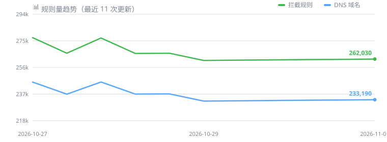

<div align="center">

<a id="top"></a>

# 🛸 天影规则聚合 · TianYing Rules Hub

**⚡ 强力去广告 · 每 12 小时自动更新 · 全平台适配 ⚡**

> 干净的网络，从一条订阅开始 —— 21 路数据源聚合 · 三层真实去重 · 每 12 小时自动更新，一套规则覆盖 10 种格式

[](https://github.com/xiaolei7172/ADS/actions/workflows/Update-Rules.yml)
[](https://github.com/xiaolei7172/ADS/commits/master)
[](LICENSE)

[📥 规则订阅](#-规则订阅中心) · [🚀 快速开始](#-快速开始) · [📦 客户端下载](#-客户端下载速查) · [📊 实时统计](#-实时项目统计) · [📚 上游数据源](#-上游规则数据源) · [🧪 拦截测试](#-拦截效果在线测试)

---

## 📊 实时项目统计

### 🔮 天影规则聚合 · 实时规则规模


🕒 **更新时间**：2026-11-01 00:30:44（北京时间）


🚫 **广告拦截规则**：262030 条


🌐 **DNS 拦截域名**：233190 个


✅ **白名单放行规则**：6718 条

<!-- DL_STATUS_START -->
⚠️ **上游源状态**：20/21 成功，失败：海哥规则（curl 退出码 60）
<!-- DL_STATUS_END -->



<!-- 🏷️ 动态徽章：① 在 gist.github.com 新建一个 Gist；② 仓库 Settings → Secrets 新建 GIST_SECRET（需 gist 权限的 Token）、Settings → Variables 新建 GIST_ID（填 Gist ID）；③ 取消下一行注释并把 <GIST_ID> 换成实际 ID

-->

---

## 🎯 六大保障

| 保障 | 说明 |
| :--- | :--- |
| 🧹 **真实去重** | 精确去重 + 大小写归一 + 父子域语义去重，0 冗余规则 |
| 🛡️ **质量闸门** | 每次发布前自检重复/冗余/计数自洽，不合格自动拦截 |
| 🚧 **发布护栏** | 规则量骤降 >10% 或低于 5 万条即中止发布，绝不带病上线 |
| 🧯 **投毒熔断** | 白名单移除拦截规则 >8%（正常 ≈2%）即判定投毒/黑白错配，中止发布；下载阶段同步做黑白方向体检 |
| 🌐 **多源容灾** | GitHub API + 3 个 jsDelivr 子域 + gh-proxy 共 6 通道下载兜底 |
| 📋 **来源可溯** | 每条规则标注所属上游来源，排查误杀一步定位 |

---

## 🚀 快速开始

> 💡 先把客户端装好，再贴订阅链接。下面全部为**官方来源**（链接已实测可达）；GitHub Releases 在国内不稳时，可在链接前加 `https://gh-proxy.com/` 加速。

### 📦 客户端下载速查

| 软件 | 适用平台 | 官方下载 | 备注 |
| :--- | :--- | :--- | :--- |
| **AdGuard** | Windows / macOS / Android | [官网下载](https://adguard.com/zh_cn/download.html) | 商业软件（有试用），系统级全局拦截 |
| **AdGuard Home** | Win / macOS / Linux / Docker | [GitHub Releases](https://github.com/AdguardTeam/AdGuardHome/releases) | 免费开源，自建 DNS 服务器 |
| **OpenWrt** | 路由器 | [固件选择器](https://firmware-selector.openwrt.org/) · [ImmortalWrt](https://github.com/immortalwrt/immortalwrt) | 免费开源路由系统，国内推荐后者 |
| **SmartDNS** | Linux / OpenWrt | [GitHub Releases](https://github.com/pymumu/smartdns/releases) | 免费开源，DNS 加速 + 拦截 |
| **Clash Verge Rev** | Win / macOS / Linux | [GitHub Releases](https://github.com/clash-verge-rev/clash-verge-rev/releases) | 免费开源图形客户端，最常用 |
| **Mihomo Party** | Win / macOS / Linux | [GitHub Releases](https://github.com/mihomo-party-org/mihomo-party/releases) | 免费开源，开箱即用 |
| **Mihomo 内核** | 全平台（命令行） | [GitHub Releases](https://github.com/MetaCubeX/mihomo/releases) | 进阶自建 / 软路由用 |
| **Quantumult X** | iOS / iPadOS | [App Store](https://apps.apple.com/app/quantumult-x/id1443988620) | 付费买断，需美区/港区账号 |
| **Surge** | iOS / macOS | [nssurge.com](https://nssurge.com) | 付费订阅；官网国内直连不稳，需自备网络 |

<details open>
<summary><b>🖥️ AdGuard（Windows / Mac / Android）</b></summary>
<br>

> 📥 下载：[Windows](https://adguard.com/zh_cn/adguard-windows/overview.html) · [macOS](https://adguard.com/zh_cn/adguard-mac/overview.html) · [Android](https://adguard.com/zh_cn/adguard-android/overview.html) · [全部平台](https://adguard.com/zh_cn/download.html)

1. 打开 AdGuard → 设置 → **内容拦截**（Windows 为「过滤器」）
2. 点击「添加过滤器」→「使用自定义过滤器」
3. 粘贴订阅链接（国内网络选加速列）：
   `https://testingcf.jsdelivr.net/gh/xiaolei7172/ADS@master/data/rules/adblock.txt`
4. 建议同时启用白名单：`https://testingcf.jsdelivr.net/gh/xiaolei7172/ADS@master/data/rules/allow.txt`

</details>

<details>
<summary><b>🌐 AdGuard Home</b></summary>
<br>

> 📥 下载：[GitHub Releases](https://github.com/AdguardTeam/AdGuardHome/releases) · 也支持 Docker（`docker run -p 53:53/tcp -p 53:53/udp -p 3000:3000 adguard/adguardhome`）

1. 管理后台 → 过滤器 → **DNS 拦截列表** → 添加拦截列表
2. 粘贴：`https://testingcf.jsdelivr.net/gh/xiaolei7172/ADS@master/data/rules/dns.txt`
3. 白名单（自定义过滤规则 → 放行）：`https://testingcf.jsdelivr.net/gh/xiaolei7172/ADS@master/data/rules/allow.txt`

</details>

<details>
<summary><b>📡 OpenWrt（hosts 方式）</b></summary>
<br>

> 📥 固件：[官方固件选择器](https://firmware-selector.openwrt.org/) · [ImmortalWrt（国内源更全）](https://github.com/immortalwrt/immortalwrt) · OpenClash 插件：[Releases](https://github.com/vernesong/OpenClash/releases)

1. 下载 hosts 文件：`https://testingcf.jsdelivr.net/gh/xiaolei7172/ADS@master/data/rules/hosts.txt`
2. 覆盖到 `/etc/hosts` 末尾（或配合 dnsmasq 的 `addn-hosts` 引用）
3. 重启 dnsmasq：`/etc/init.d/dnsmasq restart`

</details>

<details>
<summary><b>🔍 SmartDNS</b></summary>
<br>

> 📥 下载：[GitHub Releases](https://github.com/pymumu/smartdns/releases)（OpenWrt 可直接 `opkg install smartdns`）

1. 编辑 `smartdns.conf`，加入：`conf-file https://testingcf.jsdelivr.net/gh/xiaolei7172/ADS@master/data/rules/smartdns.conf`
   （或下载后 `include` 到主配置）
2. 误杀放行：`conf-file .../data/rules/smartdns-whitelist.conf`
3. 重启服务：`/etc/init.d/smartdns restart`

</details>

<details>
<summary><b>🧩 Clash / Mihomo</b></summary>
<br>

> 📥 客户端：[Clash Verge Rev](https://github.com/clash-verge-rev/clash-verge-rev/releases) · [Mihomo Party](https://github.com/mihomo-party-org/mihomo-party/releases) · [Mihomo 内核](https://github.com/MetaCubeX/mihomo/releases)

```yaml
rule-providers:
  tianying-ad:
    type: http
    behavior: domain
    url: "https://testingcf.jsdelivr.net/gh/xiaolei7172/ADS@master/data/rules/mihomo.yaml"
    path: ./rules/tianying-ad.yaml
    interval: 43200
rules:
  - RULE-SET,tianying-ad,REJECT
```

</details>

---

## 📥 规则订阅中心

> 💡 国内网络推荐优先使用「国内加速链接」（jsDelivr，实测可用）；GitHub 直连不稳时再换直链。
> PC 版 AdGuard 选 `adblock.txt`；AdGuard Home / OpenWrt 选 `dns.txt`。

<details open>
<summary><b>🚫 广告拦截规则</b></summary>
<br>

| 规则类型 | 适用平台 | 📥 GitHub直链 | 🚀 国内加速链接 |
| :---- | :---- | :---- | :---- |
| AdGuard 拦截规则 | AdGuard 全家桶 | [adblock.txt](https://raw.githubusercontent.com/xiaolei7172/ADS/master/data/rules/adblock.txt) | [adblock.txt](https://testingcf.jsdelivr.net/gh/xiaolei7172/ADS@master/data/rules/adblock.txt) |
| AdGuard Home DNS拦截规则 | AdGuard Home / OpenWrt | [dns.txt](https://raw.githubusercontent.com/xiaolei7172/ADS/master/data/rules/dns.txt) | [dns.txt](https://testingcf.jsdelivr.net/gh/xiaolei7172/ADS@master/data/rules/dns.txt) |

</details>


<details>
<summary><b>📋 仅域名规则</b></summary>
<br>

| 规则类型 | 适用平台 | 📥 GitHub直链 | 🚀 国内加速链接 |
| :---- | :---- | :---- | :---- |
| 黑名单域名列表 | 通用（可自行转换） | [ad-domain.txt](https://raw.githubusercontent.com/xiaolei7172/ADS/master/data/rules/ad-domain.txt) | [ad-domain.txt](https://testingcf.jsdelivr.net/gh/xiaolei7172/ADS@master/data/rules/ad-domain.txt) |

</details>


<details>
<summary><b>📱 Quantumult X 规则</b></summary>
<br>

> 📥 客户端：[Quantumult X（App Store，付费）](https://apps.apple.com/app/quantumult-x/id1443988620)　|　导入位置：配置文件 →「引用」的 `[filter_remote]` 段

| 规则类型 | 适用平台 | 📥 GitHub直链 | 🚀 国内加速链接 |
| :---- | :---- | :---- | :---- |
| Quantumult X 规则 | Quantumult X | [qx.list](https://raw.githubusercontent.com/xiaolei7172/ADS/master/data/rules/qx.list) | [qx.list](https://testingcf.jsdelivr.net/gh/xiaolei7172/ADS@master/data/rules/qx.list) |

</details>


<details>
<summary><b>🔍 SmartDNS 规则</b></summary>
<br>

| 规则类型 | 适用平台 | 📥 GitHub直链 | 🚀 国内加速链接 |
| :---- | :---- | :---- | :---- |
| SmartDNS 拦截规则 | SmartDNS | [smartdns.conf](https://raw.githubusercontent.com/xiaolei7172/ADS/master/data/rules/smartdns.conf) | [smartdns.conf](https://testingcf.jsdelivr.net/gh/xiaolei7172/ADS@master/data/rules/smartdns.conf) |
| SmartDNS 白名单 | SmartDNS | [smartdns-whitelist.conf](https://raw.githubusercontent.com/xiaolei7172/ADS/master/data/rules/smartdns-whitelist.conf) | [smartdns-whitelist.conf](https://testingcf.jsdelivr.net/gh/xiaolei7172/ADS@master/data/rules/smartdns-whitelist.conf) |

</details>


<details>
<summary><b>📛 HOSTS 拦截规则</b></summary>
<br>

| 规则类型 | 适用平台 | 📥 GitHub直链 | 🚀 国内加速链接 |
| :---- | :---- | :---- | :---- |
| HOSTS 格式（0.0.0.0） | 路由器 / 系统 hosts / 无 root 安卓 | [hosts.txt](https://raw.githubusercontent.com/xiaolei7172/ADS/master/data/rules/hosts.txt) | [hosts.txt](https://testingcf.jsdelivr.net/gh/xiaolei7172/ADS@master/data/rules/hosts.txt) |

</details>


<details>
<summary><b>✅ 白名单规则</b></summary>
<br>

| 规则类型 | 适用平台 | 📥 GitHub直链 | 🚀 国内加速链接 |
| :---- | :---- | :---- | :---- |
| 白名单规则（误杀放行） | AdGuard 全家桶 | [allow.txt](https://raw.githubusercontent.com/xiaolei7172/ADS/master/data/rules/allow.txt) | [allow.txt](https://testingcf.jsdelivr.net/gh/xiaolei7172/ADS@master/data/rules/allow.txt) |

</details>


<details>
<summary><b>🧩 Clash / Mihomo / Surge 规则</b></summary>
<br>

> 📥 客户端：[Clash Verge Rev](https://github.com/clash-verge-rev/clash-verge-rev/releases) · [Mihomo Party](https://github.com/mihomo-party-org/mihomo-party/releases) · [Surge](https://nssurge.com)（付费，官网需自备网络）

| 规则类型 | 适用平台 | 📥 GitHub直链 | 🚀 国内加速链接 |
| :---- | :---- | :---- | :---- |
| Mihomo 域名集 | Clash / Mihomo / Stash（behavior: domain） | [mihomo.yaml](https://raw.githubusercontent.com/xiaolei7172/ADS/master/data/rules/mihomo.yaml) | [mihomo.yaml](https://testingcf.jsdelivr.net/gh/xiaolei7172/ADS@master/data/rules/mihomo.yaml) |
| Surge 规则集 | Surge / Loon（RULE-SET） | [surge.list](https://raw.githubusercontent.com/xiaolei7172/ADS/master/data/rules/surge.list) | [surge.list](https://testingcf.jsdelivr.net/gh/xiaolei7172/ADS@master/data/rules/surge.list) |

</details>


<details>
<summary><b>🔄 公共 DNS 服务器节点</b></summary>
<br>

| 节点 | 地址 |
| :---- | :---- |
| 天影公共 DNS | `https://tianying.pub.xlxbk.cn/xlxbk/api` |
| 18bit DoH | `https://doh.18bit.cn/dns-query` |
| 360 DoH | `https://doh.360.cn/dns-query` |
| 阿里 DoH | `https://dns.alidns.com/dns-query` |
| 腾讯 DoH | `https://doh.pub/dns-query` |
| XLXBK API | `https://pub.xlxbk.cn/xlxbk/api` |

</details>

</div>


## 📚 上游规则数据源

> 管线实际下载 **21 路源**（15 个拦截 + 6 个白名单），另有 2 个本仓库自定义文件。
> 其中「合并源」本身已聚合多个二级上游，因此实际覆盖的项目数量多于 19。
> 每个来源在成品中都有分区标注，误拦可直接定位到源。

<details>
<summary><b>点击查看全部数据来源</b></summary>
<br>

### 🔴 拦截规则（14 路）

| 来源 | 侧重 | 原始地址 |
| :--- | :--- | :--- |
| 📛 **1007-Hosts** | Hosts 混合源 | [10007_auto/all](https://raw.githubusercontent.com/lingeringsound/10007_auto/master/all) |
| 📛 **1007-保留奖励名单** | 奖励类域名保留 | [10007_auto/reward](https://raw.githubusercontent.com/lingeringsound/10007_auto/master/reward) |
| 📛 **anti-AD 官方规则** | 命中率高、兼容性强 | [anti-ad.net/easylist.txt](https://anti-ad.net/easylist.txt) |
| 📛 **AdRules DNS List** | DNS 专用 | [gp.adrules.top/dns.txt](https://gp.adrules.top/dns.txt) |
| 📛 **AdGuard DNS Filter 官方** | DNS 专用（官方维护） | [AdGuardSDNSFilter](https://adguardteam.github.io/AdGuardSDNSFilter/Filters/filter.txt) |
| 📛 **OISD 拦截规则** | DNS 专用，低误杀 | [small.oisd.nl](https://small.oisd.nl/) |
| 📛 **个人合并规则** | 合并源（群主维护） | [666/rules.txt](https://raw.githubusercontent.com/qq5460168/666/master/rules.txt) |
| 📛 **酷安@大萌主** | 接口 / SDK 广告 | [banad/jiekouAD.txt](https://raw.githubusercontent.com/damengzhu/banad/main/jiekouAD.txt) |
| 📛 **浮风拦截规则** | 合并源 | [ad-rules-merged](https://raw.githubusercontent.com/Thelongdarkorg/ad-rules-merged/main/merged.txt) |
| 📛 **海哥规则** | 综合拦截 | [hgzs.uunat.com/hg1.txt](http://hgzs.uunat.com/hg1.txt) |
| 📛 **秋风广告规则** | 综合拦截 | [AWAvenue-Ads-Rule](https://raw.githubusercontent.com/TG-Twilight/AWAvenue-Ads-Rule/main/AWAvenue-Ads-Rule.txt) |
| 📛 **乘风视频规则** | 视频贴片广告 | [Adblock-Plus-Rule/mv.txt](https://raw.githubusercontent.com/xinggsf/Adblock-Plus-Rule/master/mv.txt) |
| 📛 **乘风通用规则** | 通用拦截 | [Adblock-Plus-Rule/rule.txt](https://raw.githubusercontent.com/xinggsf/Adblock-Plus-Rule/master/rule.txt) |
| 📛 **晴雅拦截规则** | 综合拦截 | [qy-Ads-Rule/black.txt](https://raw.githubusercontent.com/rssvcn/qy-Ads-Rule/main/black.txt) |
| 📛 **abclq Hosts 拦截规则** | Hosts 综合拦截 | [home-dns-adblock hosts](https://raw.githubusercontent.com/abclq/home-dns-adblock/refs/heads/main/dist/hosts.txt) |
| 🏠 **本仓库自定义** | 红果短剧 / 番茄小说专项等 | [data/mod/adblock.txt](https://raw.githubusercontent.com/xiaolei7172/ADS/master/data/mod/adblock.txt) |

### 🟢 白名单规则（6 路 + 自定义）

| 来源 | 侧重 | 原始地址 |
| :--- | :--- | :--- |
| ✅ **当初白名单** | 综合放行 | [dangchu/white.txt](https://raw.githubusercontent.com/qq5460168/dangchu/main/white.txt) |
| ✅ **李文杰白名单** | 中文站点放行 | [adg-rules/white.txt](https://raw.githubusercontent.com/liwenjie119/adg-rules/master/white.txt) |
| ✅ **AdGuard 中文白名单** | 官方中文放行 | [ChineseFilter/allowlist](https://raw.githubusercontent.com/AdguardTeam/AdguardFilters/master/ChineseFilter/sections/allowlist.txt) |
| ✅ **AdGuard 跟踪白名单** | 官方隐私放行 | [SpywareFilter/allowlist](https://raw.githubusercontent.com/AdguardTeam/AdguardFilters/master/SpywareFilter/sections/allowlist.txt) |
| ✅ **BlueSkyXN 白名单** | AdGuard Home 专用 | [AdGuardHomeRules/ok.txt](https://raw.githubusercontent.com/BlueSkyXN/AdGuardHomeRules/master/ok.txt) |
| ✅ **abclq 防误杀白名单** | 红果/抖音正片 CDN 防误杀（裸域名格式，自动转换） | [home-dns-adblock whitelist](https://raw.githubusercontent.com/abclq/home-dns-adblock/refs/heads/main/config/whitelist.txt) |
| 🏠 **本仓库自定义** | 误杀补救（优先级最高） | [data/mod/whitelist.txt](https://raw.githubusercontent.com/xiaolei7172/ADS/master/data/mod/whitelist.txt) |

### 🧽 上游脏数据清洗

合并过程中会主动丢弃以下三类"看着像规则、实际有害或无效"的行：

| 类型 | 为例 | 为什么要丢 |
| :--- | :--- | :--- |
| `$badfilter` | `pl.ua^$badfilter` | AdGuard 里用于取消规则，留着等于反向放行广告 |
| 尾点多一个句点 | `advertising.civitai.` | 语法无效，纯废行 |
| 非回环 IP 映射行 | `110.43.121.13 bigota.d.miui.com` | 这是 hosts 加速映射而非拦截，会把域名强行指向某个 IP |

### 🔬 新源接入：先验证，后接入

收到一个新规则源 URL 时，不直接挂进管线，先用**源探针**验证：

```bash
python data/python/probe_source.py <规则源URL>          # 自动分辨黑白名单 + 冲突预演
python data/python/probe_source.py <规则源URL> allow    # 已知是白名单时强制按白名单分析
python data/python/probe_source.py <规则源URL> block    # 已知是黑名单时强制按黑名单分析
```

探针会输出四段报告：

| 环节 | 回答的问题 |
| :--- | :--- |
| 📥 试下载 | 六通道镜像能否拉到？是不是 404/挑战页冒充的规则？ |
| 🧭 黑白判定 | 放行(@@)/拦截(\|\|)/hosts 语法占比 + 文件名关键词，自动判定它是白名单还是黑名单 |
| ⚗️ 冲突预演 | 白名单：将解封现有多少条拦截规则（列出域名明细）；黑名单：与现有规则重叠多少、净新增多少 |
| 📌 接入建议 | 该进 `allow_rules` 还是 `adblock_rules`，后续验证跑哪些脚本 |

**黑白名单怎么分辨？** 核心看语法而非文件名：

| 特征 | 白名单 | 黑名单 |
| :--- | :--- | :--- |
| `@@\|\|domain^` | ✅ 主要成分 | 一般少量（上游自带防误杀） |
| `\|\|domain^` / `0.0.0.0 domain` | 一般少量 | ✅ 主要成分 |
| 裸域名（一行一个域名） | 看文件名：whitelist/allow 等 → 按 `@@\|\|domain^` 转换接入 | 看文件名：adblock/hosts 等 → 作拦截域名接入 |

**正式管线的双保险**（探针之外的自动防线）：

- **下载方向体检**（dl.py）：白名单文件里拦截语法占大头 / 黑名单文件里放行语法占大头，下载阶段当场报警；
- **白名单污染熔断**（merge.py）：若白名单放行移除的拦截规则超过 **8%**（正常水位 ≈2%），判定白名单被投毒或黑白错配，中止发布残缺规则。

</details>


## 🧪 拦截效果在线测试

<div align="center">
  <p><b>🔗 点击以下链接测试广告拦截效果</b></p>

  <a href="https://adblock-tester.com">
    
  </a>

  <a href="https://blockads.fivefilters.org/">
    
  </a>

  <a href="https://adblock.turtlecute.org/">
    
  </a>
</div>

---

<div align="center">

**⭐ 如果这个项目对你有帮助，欢迎点个 Star ⭐**

🙏 致敬 8680 大佬 · 各上游规则作者

💬 遇到 **误拦 / 漏拦**？[提交 Issue](https://github.com/xiaolei7172/ADS/issues/new/choose) 反馈，误拦会优先加白名单放行

📄 [MIT License](LICENSE) · 🔄 每 12 小时自动更新 · [⬆ 返回顶部](#top)

</div>
